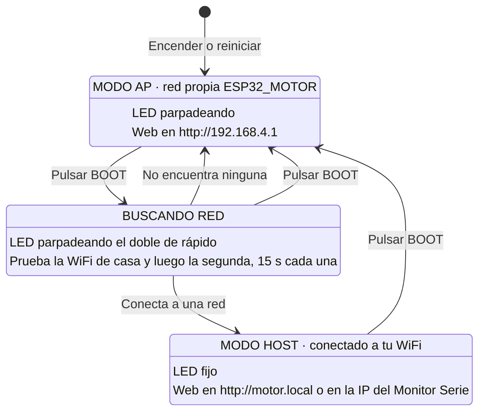

# Control motor paso a paso

Programa para ESP32 (Arduino IDE) que controla un motor paso a paso y dos relés desde una página web. El ESP32 crea su propia red WiFi o se conecta a la de casa, y la página se abre desde el móvil o el PC sin instalar nada.

Funciona con cualquier driver de entradas STEP y DIR: A4988, DRV8825, TMC2208, TB6600, DM542 y similares.

## Funciones

- Giro del motor con velocidad regulable (10 a 300 rpm) y ángulos de avance y de retroceso de 0 a 360 grados.
- Dos relés temporizados, por separado o en serie: uno durante su tiempo y, al apagarse, el otro.
- Disparo: avance, retroceso, espera y encendido de los relés en una sola orden.
- Secuencia automática al detectar pienso. El sensor aún no está conectado: la página permite elegir la secuencia y simular la detección.
- Red propia (modo AP) o WiFi de casa (modo host), con cambio de modo en el botón BOOT de la placa.
- Órdenes HTTP sencillas para controlarlo también desde otro programa.
- Las mismas órdenes por el cable USB (puerto serie), con una app para el PC que no necesita WiFi.
- Mensajes de depuración y diagnóstico por el Monitor Serie, con medidas de rendimiento: regularidad de los pulsos, bucle principal y memoria.

## Material

| Componente | Modelo usado |
|---|---|
| Placa | ESP32 WROOM-32 (ESP32 Dev Module) |
| Driver | Pololu DRV8825 |
| Motor | 17HS19-2004S1, 200 pasos por vuelta |
| Relés | Módulo de dos relés |

La carpeta [docu](docu) tiene las hojas de datos y, en [docu/readme.txt](docu/readme.txt), el cableado completo, el ajuste de corriente del driver y el microstepping.

## Conexiones

**Driver del motor:**

| ESP32 | Driver | En drivers optoacoplados (TB6600) |
|---|---|---|
| GPIO 33 (D33) | STEP | PUL+ |
| GPIO 32 (D32) | DIR | DIR+ |
| GPIO 25 (D25) | EN | ENA+ |
| GND | GND lógico | PUL-, DIR- y ENA- |

**Módulo de relés:**

| ESP32 | Módulo | Función |
|---|---|---|
| GPIO 27 (D27) | IN1 | Relé 1 |
| GPIO 13 (D13) | IN2 | Relé 2 |
| VIN (5 V) o 3V3 | VCC | Según la tensión del módulo |
| GND | GND | Masa común |

- El ESP32 da señales de 3,3 V. A4988, DRV8825 y TMC2208 las aceptan directamente; algunos drivers optoacoplados necesitan 5 V.
- La alimentación del motor va al driver, nunca al ESP32. Las masas del ESP32 y del driver van unidas.
- Los GPIO 34, 35, 36 (VP) y 39 (VN) son solo de entrada y no sirven como salidas: el programa no compila si se ponen en un pin de salida.
- Los relés no deben ir en GPIO 14 ni 15, que dan pulsos durante el arranque del ESP32.

## Instalación

1. En Arduino IDE, instala el soporte de ESP32 de Espressif Systems desde el Gestor de placas. Si no aparece, añade esta dirección en Archivo, Preferencias, "Gestor de URLs adicionales de tarjetas":

   ```
   https://espressif.github.io/arduino-esp32/package_esp32_index.json
   ```

2. En la carpeta `control_motor_paso_a_paso`, copia `credenciales.h.ejemplo` como `credenciales.h` y escribe el nombre y la clave de tu WiFi, y opcionalmente de una segunda red. El ESP32 solo usa redes de 2,4 GHz. `credenciales.h` está en `.gitignore` y no se sube al repositorio.
3. Abre `control_motor_paso_a_paso/control_motor_paso_a_paso.ino`, elige la placa "ESP32 Dev Module" y el puerto del ESP32.
4. Pulsa Subir. Si sale "Wrong boot mode", mantén pulsado BOOT, pulsa y suelta EN, y sigue con BOOT pulsado hasta que salga "Writing at".

No hace falta instalar librerías: todo lo que usa el programa viene con el soporte de ESP32.

## Uso

### Modos WiFi

El ESP32 tiene dos modos de red. Una pulsación corta del botón **BOOT** cambia de uno a otro y el **LED azul** indica en cuál está.



| LED | Modo | Para abrir la página | Al pulsar BOOT |
|---|---|---|---|
| Parpadeando | AP: red propia | Conecta el móvil a `ESP32_MOTOR` (clave `12345678`) y abre `http://192.168.4.1` | Busca tu WiFi |
| Parpadeando el doble de rápido | Buscando tu WiFi | No hay página mientras busca | Vuelve al modo AP |
| Fijo | Host: conectado a tu WiFi | Desde la misma WiFi, abre `http://motor.local` o la IP que sale en el Monitor Serie | Vuelve al modo AP |

- El ESP32 siempre arranca en modo AP. Durante los 3 primeros segundos BOOT no hace nada, para que no cuente si seguía pulsado al encender o al cargar el programa.
- Si no conecta a ninguna red, vuelve solo al modo AP.
- Si en modo host se cae la WiFi, el LED parpadea rápido mientras reconecta solo.
- **Cada cambio de modo para el motor, cancela el disparo y apaga los relés,** porque se pierde la conexión con la página.

### Página de control

**Motor.** Tres deslizadores y los botones **Avanzar**, **Retroceder** y **Parar**:

| Deslizador | Qué hace |
|---|---|
| Velocidad | De 10 a 300 rpm (`RPM_MIN` y `RPM_MAX`). Se aplica al soltarlo, también al giro en curso. Al encender el ESP32 vuelve a 25 rpm (`RPM_INICIAL`) |
| Ángulo de avance | De 0 a 360 grados: lo que gira **Avanzar**, a la derecha |
| Ángulo de retroceso | De 0 a 360 grados: lo que gira **Retroceder**, a la izquierda |

Junto a cada ángulo se ven los pasos equivalentes. Con 200 pulsos por vuelta, cada paso son 1,8 grados. El navegador recuerda los ángulos. Mientras el motor gira, las órdenes de mover se rechazan hasta que termina o se pulsa Parar.

**Relés.** Cada relé tiene su tiempo en segundos (1 s por defecto, 600 s como máximo):

| Botón | Qué hace |
|---|---|
| Activar relé 1 / Activar relé 2 | Enciende ese relé durante su tiempo y se apaga solo |
| Relé 1 y luego relé 2 | Enciende el relé 1 y, al apagarse, el relé 2, cada uno con su tiempo |
| Relé 2 y luego relé 1 | Lo mismo en el orden contrario |

En una serie, el segundo relé espera apagado su turno. Una orden suelta a cualquier relé cancela la serie pendiente, y una serie nueva sustituye a la anterior.

**Disparo.** El botón **Realizar disparo** hace en orden:

1. Avanza el ángulo de avance.
2. Retrocede el ángulo de retroceso; con 0 grados no retrocede.
3. Espera 1 segundo (`DISPARO_ESPERA_MS`).
4. Enciende los relés según la opción elegida: relé 1, relé 2, 1 y luego 2, o 2 y luego 1.

Parar, una orden de girar o un cambio de modo cancelan el disparo mientras gira o espera. Si los relés ya se han encendido, siguen hasta acabar su tiempo.

**Sensor de pienso (maqueta).** El sensor aún no está implementado. El bloque morado tiene:

- La casilla **Disparo automático al detectar pienso**, que activa o desactiva la secuencia.
- La secuencia que se lanzará: relé 1, relé 2, 1 y luego 2, o 2 y luego 1, con los tiempos de los relés.
- El botón **Simular detección**, que actúa como si el sensor hubiera visto pienso. El piloto se pone verde 2 segundos en cada detección.

La selección se guarda en la memoria del ESP32 al cambiarla y se conserva al apagarlo. Para conectar el sensor real, basta con leerlo en `loop()` y llamar a `piensoDetectado()` al detectar pienso.

**Estado.** El último bloque muestra si el motor gira o está parado, con o sin corriente, la fase del disparo, el tiempo que le queda a cada relé y, durante una serie, qué relé va después.

## Configuración

Todos los parámetros están al principio de `control_motor_paso_a_paso.ino`:

| Parámetro | Valor | Qué hace |
|---|---|---|
| `STEP_PIN` | 33 | GPIO conectado a STEP |
| `DIR_PIN` | 32 | GPIO conectado a DIR |
| `ENABLE_PIN` | 25 | GPIO conectado a EN, para cortar la corriente del motor en reposo |
| `ENABLE_ACTIVO` | LOW | Nivel de EN que activa el driver. LOW en DRV8825 y A4988 |
| `DESACTIVAR_EN_REPOSO` | true | Corta la corriente del motor cuando lleva `REPOSO_MS` parado. Pon `false` si una carga puede mover el eje en reposo |
| `REPOSO_MS` | 500 | Tiempo parado antes de cortar la corriente |
| `ENABLE_ESPERA_MS` | 5 | Espera tras dar corriente antes del primer paso |
| `RELE1_PIN` | 27 | GPIO del relé 1 |
| `RELE2_PIN` | 13 | GPIO del relé 2 |
| `RELE_ACTIVO` | HIGH | Nivel que enciende los relés. Muchos módulos con optoacoplador usan LOW |
| `RELE_TIEMPO_S` | 1 | Tiempo por defecto de cada relé en la página, en segundos |
| `RELE_MAX_S` | 600 | Tiempo máximo de cada relé por orden |
| `DISPARO_ESPERA_MS` | 1000 | Espera del disparo entre el final del giro y el encendido de los relés |
| `PULSOS_POR_VUELTA` | 200 | Pulsos para una vuelta. Con microstepping se multiplica: 1/8 son 1600, 1/16 son 3200 |
| `RPM_INICIAL` | 25 | Velocidad al encender, en vueltas por minuto |
| `RPM_MIN` / `RPM_MAX` | 10 / 300 | Límites del deslizador de velocidad. No hay rampa de aceleración: si el motor pierde pasos, baja `RPM_MAX` |
| `DIR_DERECHA` | HIGH | Nivel de DIR para girar a la derecha. Cámbialo a LOW si gira al revés |
| `DIR_SETUP_US` | 5 | Espera entre cambiar DIR y el primer pulso |
| `VUELTAS_MAX` | 1000 | Máximo de vueltas por orden HTTP |
| `LED_PIN` | 2 | LED de estado de la WiFi, el azul de la placa |
| `LED_AP_MS` | 500 | Medio periodo del parpadeo en modo AP |
| `BOTON_MODO_PIN` | 0 | Botón que cambia de modo: el BOOT de la placa |
| `ARRANQUE_GRACIA_MS` | 3000 | Tiempo tras encender en el que BOOT no hace nada |
| `ANTIRREBOTE_MS` | 50 | Filtro de rebotes del botón |
| `TIEMPO_CONEXION_MS` | 15000 | Tiempo máximo intentando conectar a cada red en modo host |
| `NOMBRE_RED` | motor | En modo host, la página se abre también en `http://motor.local` |
| `WIFI_SSID` | ESP32_MOTOR | Nombre de la red propia |
| `WIFI_PASSWORD` | 12345678 | Clave de la red propia, de 8 caracteres como mínimo |
| `WIFI_CANAL` | 6 | Canal de la red propia |
| `WIFI_POTENCIA` | 8,5 dBm | Potencia de la red propia. En placas clónicas la red no aparece a potencia máxima |
| `WEB_MAX_CONEXIONES` | 7 | Conexiones a la página abiertas a la vez. Si se llenan, se cierra la menos usada |
| `WEB_ESPERA_S` | 2 | Segundos máximos que el servidor espera a un navegador que no envía ni recibe |
| `DEPURACION` | true | Mensajes de depuración por el Monitor Serie |
| `DEPURAR_ESTADO` | false | Muestra también las consultas `/estado` de cada segundo |
| `DIAGNOSTICO_MS` | 30000 | Cada cuánto sale la línea de diagnóstico `[sistema]` |

## Órdenes HTTP

La página usa estas direcciones, que también se pueden llamar desde otro programa. Todas son `GET` y responden con un texto, salvo `/` (la página) y `/estado` (JSON).

| Dirección | Qué hace |
|---|---|
| `/` | Página de control |
| `/mover?vueltas=0.25&sentido=der` | Gira 0,25 vueltas. `sentido` es `der` o `izq` |
| `/parar` | Para el motor y cancela el disparo pendiente |
| `/velocidad?rpm=120` | Cambia la velocidad, de `RPM_MIN` a `RPM_MAX` |
| `/rele?n=1&segundos=1` | Enciende el relé `n` (1 o 2) durante ese tiempo |
| `/serie?orden=12&segundos1=1&segundos2=3` | Relés en serie: `12` es primero el 1 y luego el 2; `21`, al revés. `segundos1` es siempre el tiempo del relé 1 |
| `/disparo?vueltas=0.25&sentido=der&retroceso=0.125&modo=12&segundos1=1&segundos2=3` | Disparo: gira `vueltas`, retrocede `retroceso` (opcional), espera `DISPARO_ESPERA_MS` y enciende los relés según `modo`: `1`, `2`, `12` o `21` |
| `/automatico?activo=1&modo=21&segundos1=1&segundos2=3` | Guarda la secuencia automática del sensor de pienso: activada (`1`) o no (`0`), modo y tiempos |
| `/pienso` | Simula una detección de pienso |
| `/estado` | Estado en JSON (ver abajo) |
| `/diagnostico` | Medidas de rendimiento en JSON (ver [Rendimiento](#rendimiento)). Con `?reiniciar=1` pone los contadores a cero después de leerlos |
| `/wifi?modo=ap` | Cambia de modo como el botón BOOT: `ap`, `host` o `apagado` (sin WiFi, para pruebas). Para el motor y apaga los relés. Pensada para el puerto serie: por la web se pierde la conexión |

Campos de `/estado`:

| Campo | Contenido |
|---|---|
| `moviendo`, `pulsos_pendientes`, `sentido` | Si el motor gira, cuántos pulsos le faltan y hacia dónde |
| `pulsos_por_vuelta`, `rpm`, `con_corriente` | Configuración del motor, velocidad actual y si las bobinas tienen corriente |
| `rele`, `rele_ms_restantes` | Relé 1: encendido o no y milisegundos que le quedan |
| `rele2`, `rele2_ms_restantes` | Lo mismo para el relé 2 |
| `serie_siguiente`, `serie_ms` | En una serie, relé que se enciende después y su tiempo (0 si no hay serie) |
| `disparo`, `disparo_modo` | Fase del disparo (`girando`, `retrocediendo`, `esperando` o vacío) y su modo |
| `auto_activo`, `auto_modo` | Secuencia automática del sensor de pienso |
| `pienso_detecciones` | Detecciones de pienso desde el arranque |

## Control desde el PC por el puerto serie

Todas las órdenes de la tabla anterior, salvo la página `/`, se pueden escribir también en el Monitor Serie, una por línea y con la misma forma: `/mover?vueltas=0.25&sentido=der`. El ESP32 contesta con una línea que empieza por `>`, el código y el texto:

```
/velocidad?rpm=120
> 200 Velocidad: 120 rpm
```

La carpeta [pc](pc) tiene `control_serie.py`, una app para el PC que usa el puerto serie, sin WiFi. Necesita Python y pyserial (`py -m pip install pyserial`). Antes de abrirla, cierra el Monitor Serie de Arduino IDE, porque el puerto solo lo puede usar un programa a la vez.

| Orden | Qué hace |
|---|---|
| `py pc/control_serie.py` | Ventana con el motor, los relés, el disparo, el estado y el Monitor Serie |
| `py pc/control_serie.py --orden /estado` | Envía una o varias órdenes (`--orden` repetido) y muestra las respuestas |
| `py pc/control_serie.py --prueba` | Prueba de rendimiento: gira unas 3 s a 25, 100, 200 y 300 rpm (`--rpm` para otras) y muestra la regularidad de los pulsos |
| `py pc/control_serie.py --monitor 30` | Muestra el Monitor Serie durante 30 s |

Busca sola el puerto del ESP32; si hay varios, indícalo con `--puerto COM3`.

## Monitor Serie y diagnóstico

El Monitor Serie, a **115200 baudios**, muestra cada mensaje con los segundos desde el arranque y una etiqueta:

| Etiqueta | Qué avisa |
|---|---|
| `[wifi]` | Cambios de modo, redes probadas, dispositivos que entran o salen de la red propia y caídas del router con su motivo |
| `[web]` | Cada petición: IP, orden, código de respuesta y texto. También los envíos que tardan un segundo o más |
| `[motor]` | Fin de movimiento y corte de corriente en reposo |
| `[rele]` | Apagado de cada relé y paso al segundo en una serie |
| `[disparo]` | Fases del disparo y disparos cancelados |
| `[pienso]` | Detecciones de pienso y si se lanza la secuencia automática |
| `[boton]` | Pulsación de BOOT |
| `[sistema]` | Cada 30 s: peticiones atendidas, respuestas no enviadas, envío y petición más lentos, desvío máximo de los pulsos y pulsos irregulares, pasada más larga del bucle, memoria libre, mínima y bloque mayor, y dispositivos en la red propia |

Ejemplo en modo AP:

```
[     0.812] [wifi] modo AP: red ESP32_MOTOR (clave 12345678), web en http://192.168.4.1
[    14.203] [wifi] AP: se conecta un dispositivo, MAC 4A:E5:B5:64:03:42 (conectados: 1)
[    14.951] [wifi] AP: IP asignada 192.168.4.2
[    17.330] [web] 192.168.4.2 GET / -> 200
[    21.004] [web] 192.168.4.2 GET /mover?vueltas=0.2500&sentido=der -> 200 Avanzando 90° a la derecha (50 pulsos)
[    22.618] [motor] en reposo: sin corriente
```

Las consultas `/estado` no salen salvo con `DEPURAR_ESTADO` a `true`. Con `DEPURACION` a `false` solo salen los avisos de modo y de red.

### Problemas frecuentes

| Síntoma | Causa probable |
|---|---|
| La página tarda en responder | Mala señal o un móvil con la conexión a medias. Lo indican `[web] envio lento` y el envío más lento de la línea `[sistema]` |
| La memoria libre de `[sistema]` baja y no se recupera | Pérdida de memoria en el programa |
| El motor vibra sin girar o pierde pasos | Velocidad demasiado alta o corriente del driver mal ajustada. Baja la velocidad o `RPM_MAX` |
| Gira al revés | Cambia `DIR_DERECHA` a LOW |
| Un relé se enciende al arrancar y se apaga al pulsar | El módulo se activa con LOW: cambia `RELE_ACTIVO` |
| No conecta a la WiFi de casa | Mira el motivo en el Monitor Serie (tabla de abajo) |

| Motivo de desconexión | Qué suele significar |
|---|---|
| 201 `NO_AP_FOUND` | No encuentra la red: nombre mal escrito, red de 5 GHz o fuera de alcance |
| 15 `4WAY_HANDSHAKE_TIMEOUT` o 204 `HANDSHAKE_TIMEOUT` | Casi siempre, clave incorrecta |
| 202 `AUTH_FAIL` | El router rechaza la autenticación |
| 8 `ASSOC_LEAVE` | Desconexión pedida por el propio ESP32, por ejemplo al cambiar de modo |

## Funcionamiento interno

El programa reparte el trabajo en tres partes que no se bloquean entre sí:

- **Pulsos del motor.** `moverMotor()` fija DIR, apunta cuántos pulsos hay que dar y arranca un temporizador hardware del ESP32. Su interrupción, `darPaso()`, alterna la salida STEP a intervalos fijos, medio periodo de paso según la velocidad (6 ms a 25 rpm con 200 pulsos por vuelta), pase lo que pase con la web, así que el giro no se frena mientras se atiende una petición y el número de pulsos es exacto. La interrupción corre en el núcleo 1 y la WiFi en el núcleo 0, así que la WiFi no retrasa los pulsos. El intervalo mínimo es de 50 µs.
- **Servidor web.** Usa `esp_http_server`, el servidor del sistema del ESP32, en su propia tarea. Mantiene varias conexiones abiertas, pero atiende las peticiones de una en una. Por eso:
  - El servidor deja de esperar a un navegador que no responde a los `WEB_ESPERA_S` segundos.
  - El keep-alive de TCP cierra las conexiones de móviles que ya no contestan.
  - La página pide el estado un segundo después de recibir la respuesta anterior y deja de pedirlo mientras está oculta.
  - Las peticiones de la página se abandonan si no contestan: el estado a los 3 s, las órdenes a los 5 s y Parar a los 2 s, que se reintenta hasta 5 veces.
- **Bucle principal.** `loop()` detecta el fin de cada giro, sigue las fases del disparo, apaga los relés y lanza el segundo de una serie, y atiende el botón BOOT, la búsqueda de red, el LED y el diagnóstico.

La web y el bucle principal comparten el estado del motor y de los relés con un candado (`candadoEstado`). Cada orden lo toma solo mientras cambia el estado y lo suelta antes de enviar la respuesta, para que un envío lento no frene el bucle.

La secuencia automática del sensor de pienso se guarda con `Preferences`, en la memoria no volátil del ESP32.

Las órdenes son funciones que reciben la consulta (`vueltas=0.25&sentido=der`) y devuelven el código y el texto, así que la web y el puerto serie usan las mismas. Las del puerto serie se atienden en `loop()`.

### Rendimiento

`/diagnostico` y la línea `[sistema]` miden:

| Medida | Qué es | Valor normal |
|---|---|---|
| `paso_desvio_max_us` | Lo más que se ha apartado un cambio de STEP de su medio periodo | Menos de 10 µs |
| `pasos_irregulares` | Cambios de STEP desviados más del 20 % del medio periodo | 0 |
| `bucle_max_us` | Pasada más larga de `loop()`. Una orden de mover por el puerto serie suma los 5 ms de `ENABLE_ESPERA_MS` | Unos pocos ms |
| `atencion_max_ms` | Petición web más lenta, de principio a fin | Pocos ms con buena señal |

Medidas en la placa con la prueba de `control_serie.py --prueba`, sin nadie conectado a la web:

| Versión | WiFi | Desvío máximo de los pulsos | Pulsos irregulares a 300 rpm | Bucle máximo |
|---|---|---|---|---|
| Antes, con `esp_timer` | Apagada | 5 µs | 0 | 24 ms |
| Antes, con `esp_timer` | Modo AP | 513 µs | 34 de 6000 | 24 ms |
| Antes, con `esp_timer` | Modo host buscando red | 919 µs | 14 de 1426 | 34 ms |
| Ahora, temporizador hardware | Modo AP o host | 5 µs | 0 | 7 ms |

Qué se cambió:

- **Pulsos con temporizador hardware.** `esp_timer` atiende sus avisos en una tarea del núcleo 0, la misma CPU que la WiFi, y la WiFi la retrasaba hasta casi 1 ms. A 300 rpm el medio periodo es de 500 µs, así que el motor recibía pulsos dobles o huecos y podía vibrar o perder pasos.
- **Búfer de envío del Monitor Serie** (`Serial.setTxBufferSize`). Sin búfer, cada mensaje dejaba esperando a quien lo escribía hasta que salía por el cable: la línea `[sistema]` paraba `loop()` 24 ms, y los mensajes de la web frenaban el servidor.
- **Página preparada al arrancar** (`prepararPagina()`). Antes se copiaban y rellenaban 15 KB en cada visita.
- **`/estado` en un búfer fijo**, en lugar de un `String` que se alarga campo a campo cada segundo por cada navegador abierto.
- **Sin ahorro de energía en modo host** (`WiFi.setSleep(false)`). Con el ahorro, la WiFi duerme entre balizas del router y cada petición podía esperar cientos de milisegundos.

## Estructura del repositorio

```
control_motor_paso_a_paso/
  control_motor_paso_a_paso.ino   programa completo, con la página web incluida
  credenciales.h.ejemplo          plantilla de las redes WiFi (copiar como credenciales.h)
pc/
  control_serie.py                app del PC por el puerto serie y prueba de rendimiento
docu/
  readme.txt                      cableado detallado, ajuste del driver y microstepping
  *.pdf                           hojas de datos del motor, el driver y el ULN2803
```

## Pendiente

- Sensor de pienso real: elegir el sensor, su pin y leerlo en `loop()`.
- Rampa de aceleración, para alcanzar más velocidad sin perder pasos.
