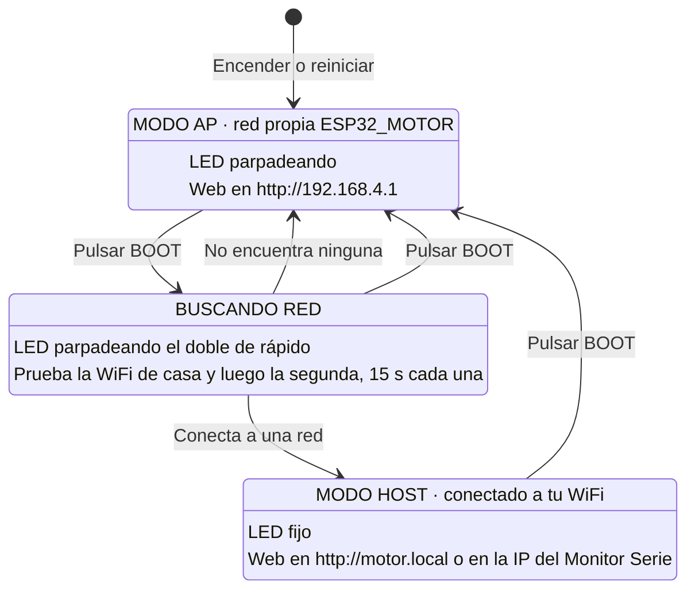

# Control motor paso a paso

Programa para ESP32 con Arduino IDE que controla un motor paso a paso y dos relés desde una página web, y los combina en un disparo: un giro, una espera y los relés. Al encender, el ESP32 crea su propia red WiFi, ESP32_MOTOR; con una pulsación del botón BOOT pasa a conectarse a la WiFi de casa. Funciona con cualquier driver de entradas STEP y DIR: A4988, DRV8825, TMC2208, TB6600, DM542 y similares.

El montaje probado usa un ESP32 WROOM-32, un driver Pololu DRV8825 y un motor 17HS19-2004S1. Sus hojas de datos y el detalle de todas las conexiones, el ajuste de corriente y el microstepping están en [docu/readme.txt](docu/readme.txt).

## Conexiones

| ESP32 WROOM | Driver | En drivers optoacoplados, tipo TB6600 |
|---|---|---|
| GPIO 33 (D33) | STEP | PUL+ |
| GPIO 32 (D32) | DIR | DIR+ |
| GPIO 25 (D25) | EN | ENA+ |
| GND | GND lógico | PUL-, DIR- y ENA- |

Conexiones de los relés:

| Dispositivo | Pin ESP32 | Pin del módulo | Descripción |
|---|---|---|---|
| Relé 1 | GPIO 27 (D27) | IN1 | Control del primer relé |
| Relé 2 | GPIO 26 (D26) | IN2 | Control del segundo relé |
| Alimentación | VIN (5 V) o 3V3 | VCC | Según las especificaciones del módulo |
| Masa | GND | GND | Masa común |

El relé 1 va a GPIO 27 (D27) y el relé 2 a GPIO 26 (D26), en las entradas IN1 e IN2 del módulo, con GND común y VCC a 5 V (VIN) o 3,3 V según el módulo. Los detalles están en [docu/readme.txt](docu/readme.txt).

En la placa de desarrollo, D33 y D32 están justo al lado de D35 y D34. Los pines D34, D35, D36 (VP) y D39 (VN) no sirven para el driver: en el ESP32 son solo de entrada. El programa no compila si se ponen en `STEP_PIN` o `DIR_PIN`.

- El ESP32 da señales de 3,3 V. A4988, DRV8825 y TMC2208 las aceptan directamente. Algunos drivers optoacoplados necesitan 5 V: si el motor no responde, revisa la hoja del driver.
- Si el driver tiene entrada ENABLE, déjala habilitada. En el A4988 y el DRV8825 lo está por defecto si no se conecta.
- La alimentación del motor va al driver, nunca al ESP32. Une las masas del ESP32 y del driver.

Los pines se cambian en `STEP_PIN` y `DIR_PIN`, al principio del programa.

## Parámetros

Todos están al principio de `control_motor_paso_a_paso.ino`:

| Parámetro | Valor inicial | Qué hace |
|---|---|---|
| `STEP_PIN` | 33 | GPIO conectado a STEP |
| `DIR_PIN` | 32 | GPIO conectado a DIR |
| `ENABLE_PIN` | 25 | GPIO conectado a EN, para cortar la corriente del motor en reposo |
| `ENABLE_ACTIVO` | LOW | Nivel de EN que activa el driver. LOW en DRV8825 y A4988 |
| `DESACTIVAR_EN_REPOSO` | true | Corta la corriente del motor cuando lleva `REPOSO_MS` parado. Pon `false` si una carga puede mover el eje en reposo |
| `REPOSO_MS` | 500 | Tiempo parado antes de cortar la corriente |
| `RELE1_PIN` | 27 | GPIO conectado a la entrada IN1 del módulo: el relé 1. Evita GPIO 14 y 15, que dan pulsos durante el arranque |
| `RELE2_PIN` | 26 | GPIO conectado a la entrada IN2 del módulo: el relé 2 |
| `RELE_ACTIVO` | HIGH | Nivel que enciende los relés. Muchos módulos con optoacoplador usan LOW |
| `RELE_TIEMPO_S` | 1 | Tiempo por defecto de cada relé en la web, en segundos |
| `RELE_MAX_S` | 600 | Tiempo máximo de cada relé por orden |
| `DISPARO_ESPERA_MS` | 1000 | Espera del disparo entre el final del giro y el encendido de los relés |
| `ENABLE_ESPERA_MS` | 5 | Espera tras dar corriente antes del primer paso |
| `PULSOS_POR_VUELTA` | 200 | Pulsos para una vuelta. Con microstepping se multiplica: 1/8 son 1600, 1/16 son 3200 |
| `PULSO_US` | 1000 | Microsegundos de STEP en alto y luego en bajo. Un paso dura el doble. Es la velocidad al encender: 150 rpm a 200 pulsos por vuelta |
| `RPM_MIN` / `RPM_MAX` | 10 / 300 | Límites del deslizador de velocidad, en vueltas por minuto. Sin rampa de aceleración, si pierde pasos a mucha velocidad, baja `RPM_MAX` |
| `LED_PIN` | 2 | LED de estado de la WiFi, el azul de la placa |
| `LED_AP_MS` | 500 | Medio periodo del parpadeo en modo AP. Buscando red parpadea el doble de rápido |
| `BOTON_MODO_PIN` | 0 | Botón que cambia de modo: el BOOT de la placa |
| `ARRANQUE_GRACIA_MS` | 3000 | Tiempo tras encender en el que BOOT no hace nada |
| `ANTIRREBOTE_MS` | 50 | Filtro de rebotes del botón |
| `TIEMPO_CONEXION_MS` | 15000 | Tiempo máximo intentando conectar a cada red en modo host |
| `NOMBRE_RED` | motor | En modo host, la web se abre también en `http://motor.local` |
| `WIFI_SSID` | ESP32_MOTOR | Nombre de la red propia del modo AP |
| `WIFI_PASSWORD` | 12345678 | Clave de la red propia, de 8 caracteres como mínimo |
| `WIFI_CANAL` | 6 | Canal de la red propia |
| `WIFI_POTENCIA` | 8,5 dBm | Potencia de la red propia. Baja porque en placas clónicas la red no aparecía a potencia máxima |
| `DIR_DERECHA` | HIGH | Nivel de DIR para girar a la derecha. Cámbialo a LOW si gira al revés |
| `DIR_SETUP_US` | 5 | Espera entre cambiar DIR y el primer pulso |
| `VUELTAS_MAX` | 1000 | Máximo de vueltas por orden |
| `WEB_MAX_CONEXIONES` | 7 | Conexiones a la web abiertas a la vez. Si se llenan, el servidor cierra la menos usada |
| `DEPURACION` | true | Muestra en el Monitor Serie quién se conecta, el estado del router y cada petición a la web |
| `DEPURAR_ESTADO` | false | Muestra también las consultas `/estado` que la página hace cada segundo |

Con `PULSO_US` a 1000 el motor da 500 pasos por segundo, que son 2,5 vueltas por segundo a 200 pulsos por vuelta. Si vibra sin girar o pierde pasos, sube `PULSO_US`.

## Cargar el programa

1. En Arduino IDE, instala el soporte de ESP32: menú Herramientas, Placa, Gestor de placas, busca "esp32" de Espressif Systems e instálalo. Si no aparece, añade esta dirección en Archivo, Preferencias, "Gestor de URLs adicionales de tarjetas":

   ```
   https://espressif.github.io/arduino-esp32/package_esp32_index.json
   ```

2. En la carpeta `control_motor_paso_a_paso`, copia `credenciales.h.ejemplo` como `credenciales.h` y pon el nombre y la clave de tus WiFi: la primera red que se prueba y, opcionalmente, una segunda. El ESP32 solo usa redes de 2,4 GHz. `credenciales.h` está en `.gitignore` y no se sube al repositorio.
3. Abre `control_motor_paso_a_paso/control_motor_paso_a_paso.ino`.
4. Elige la placa "ESP32 Dev Module" y el puerto del ESP32.
5. Pulsa Subir. Si sale "Wrong boot mode", mantén pulsado BOOT, pulsa y suelta EN, y sigue con BOOT pulsado hasta que salga "Writing at".

No hace falta instalar ninguna librería: `WiFi.h`, `ESPmDNS.h` y el servidor web `esp_http_server.h` vienen con el soporte de ESP32.

## Manual de uso: modos WiFi

El ESP32 tiene dos modos de red. Se cambia de uno a otro con una pulsación corta del botón **BOOT** de la placa, y el **LED azul** indica en cuál está.



**Qué ves y qué puedes hacer:**

| LED | Modo | Para entrar en la web | Si pulsas BOOT |
|---|---|---|---|
| Parpadeando | AP: red propia | Conecta el móvil a `ESP32_MOTOR`, clave `12345678`, y abre `http://192.168.4.1` | Pasa a buscar tu WiFi |
| Parpadeando el doble de rápido | Buscando tu WiFi | No hay web mientras busca | Cancela y vuelve al modo AP |
| Fijo | Host: conectado a tu WiFi | Con el móvil en tu WiFi, abre `http://motor.local` o la IP que sale en el Monitor Serie | Vuelve al modo AP |

**Paso a paso para usar la WiFi de casa:**

1. Enciende el ESP32 y espera a que el LED parpadee. Está en modo AP.
2. Espera al menos **3 segundos** desde que lo encendiste. Antes, BOOT no hace nada, para que no cuente si seguía pulsado al encender o al cargar el programa.
3. Da una **pulsación corta a BOOT**. El LED parpadea el doble de rápido mientras busca.
4. Si conecta, el LED se queda **fijo**. Abre `http://motor.local` desde un móvil o PC en la misma WiFi.
5. Si no encuentra ninguna red en unos 30 segundos, vuelve solo al modo AP y el LED parpadea de nuevo.

**Importante:**
- **Cada cambio de modo para el motor, cancela el disparo, apaga los dos relés y cancela la activación en serie,** porque en ese momento se pierde la conexión con la página y no podrías pararlos.
- **Si en modo host se cae la WiFi,** el LED vuelve a parpadear rápido mientras el ESP32 reconecta solo. Al recuperar la red se queda fijo de nuevo.
- **Las redes y sus claves** están en `credenciales.h`, en el orden en que se prueban.
- **El Monitor Serie,** a 115200 baudios, va contando cada paso: modo, redes probadas e IP.

## Depuración por el Monitor Serie

Abre el Monitor Serie del Arduino IDE a **115200 baudios**. Cada línea lleva delante los segundos desde el arranque, y una etiqueta según de qué trata:

| Etiqueta | Qué avisa |
|---|---|
| `[wifi]` | Cambios de modo, redes probadas, dispositivos que se conectan o desconectan de ESP32_MOTOR con su MAC e IP, y conexión o caída del router con el motivo |
| `[web]` | Cada petición a la página: IP de quien la hace, orden con sus parámetros, código de respuesta y texto. También las conexiones vacías que se cierran |
| `[motor]` | Fin de movimiento y corte de corriente en reposo |
| `[rele]` | Apagado de cada relé y, en una activación en serie, el encendido del segundo |
| `[disparo]` | Fin del giro del disparo, encendido de los relés y disparos cancelados |
| `[boton]` | Pulsación de BOOT |

Ejemplo de una sesión en modo AP:

```
[     0.812] [wifi] modo AP: red ESP32_MOTOR (clave 12345678), web en http://192.168.4.1
[     0.812] [wifi] pulsa BOOT para pasar a modo host
[    14.203] [wifi] AP: se conecta un dispositivo, MAC 4A:E5:B5:64:03:42 (conectados: 1)
[    14.951] [wifi] AP: IP asignada 192.168.4.2
[    17.330] [web] 192.168.4.2 GET / -> 200
[    21.004] [web] 192.168.4.2 GET /mover?vueltas=2&sentido=der -> 200 Girando 2.00 vueltas a la derecha (400 pulsos)
[    22.118] [web] 192.168.4.2 GET /parar -> 200 Motor parado.
[    22.618] [motor] en reposo: sin corriente
```

Las consultas `/estado` de cada segundo no salen, salvo que pongas `DEPURAR_ESTADO` a `true`. Para quitar toda la depuración, pon `DEPURACION` a `false`; los avisos de cambio de modo y de red siguen saliendo.

**Motivos de desconexión del router más habituales,** que salen como `motivo N (NOMBRE)`:

| Motivo | Qué suele significar |
|---|---|
| 201 `NO_AP_FOUND` | No encuentra la red: nombre mal escrito, red de 5 GHz o fuera de alcance |
| 15 `4WAY_HANDSHAKE_TIMEOUT` o 204 `HANDSHAKE_TIMEOUT` | Casi siempre, clave incorrecta |
| 202 `AUTH_FAIL` | El router rechaza la autenticación |
| 8 `ASSOC_LEAVE` | Desconexión pedida por el propio ESP32, por ejemplo al cambiar de modo |

## Uso de la página

La página muestra los pulsos por vuelta y tres deslizadores:

| Deslizador | Qué hace |
|---|---|
| **Velocidad** | De `RPM_MIN` a `RPM_MAX` vueltas por minuto. Se envía al soltarlo y cambia también el giro en curso. Se mantiene al recargar la página, no al apagar el ESP32 |
| **Ángulo de avance** | De 0 a 360 grados. Lo que gira el botón **Avanzar**, a la derecha |
| **Ángulo de retroceso** | De 0 a 360 grados. Lo que gira el botón **Retroceder**, a la izquierda |

Junto a cada ángulo aparecen los pasos que son: el ángulo entre 360 por `PULSOS_POR_VUELTA`, redondeado al paso más cercano. Con 200 pulsos por vuelta, cada paso son 1,8 grados y 90 grados son 50 pasos. El navegador recuerda los dos ángulos. Debajo está el botón **Parar**. La línea de estado muestra si el motor está girando y cuántos pulsos le quedan.

Mientras el motor gira, las órdenes de mover se rechazan con un aviso. Hay que esperar a que termine o pulsar Parar.

El bloque de los relés tiene un campo de tiempo para cada relé, 1 segundo por defecto, y estos botones:

| Botón | Qué hace |
|---|---|
| **Activar relé 1** | Enciende el relé 1 durante su tiempo y se apaga solo |
| **Activar relé 2** | Enciende el relé 2 durante su tiempo y se apaga solo |
| **Relé 1 y luego relé 2** | Activación en serie: enciende el relé 1 durante su tiempo y, al apagarse, el relé 2 durante el suyo |
| **Relé 2 y luego relé 1** | Activación en serie al revés: primero el relé 2 y luego el relé 1, cada uno con su tiempo |

En una activación en serie, el segundo relé espera apagado su turno. Una orden suelta a cualquier relé cancela la serie pendiente, igual que un cambio de modo con BOOT. Si se lanza otra serie mientras dura una, la nueva sustituye a la anterior.

### Disparo

El bloque naranja junta el motor y los relés. El botón **Realizar disparo** hace cuatro cosas seguidas:

1. Avanza el **Ángulo de avance**, a la derecha.
2. Retrocede el **Ángulo de retroceso**, a la izquierda. Con 0 grados se lo salta.
3. Cuando el giro termina, espera 1 segundo (`DISPARO_ESPERA_MS`).
4. Enciende los relés según la opción marcada debajo, cada uno con el tiempo de su casilla.

| Opción | Qué hace al disparar |
|---|---|
| **Relé 1** | Enciende el relé 1 |
| **Relé 2** | Enciende el relé 2 |
| **Relé 1 y luego 2** | Enciende el relé 1 y, al apagarse, el relé 2 |
| **Relé 2 y luego 1** | Enciende el relé 2 y, al apagarse, el relé 1 |

**Parar**, una orden de girar o un cambio de modo con BOOT cancelan el disparo mientras gira o espera; si los relés ya se han encendido, siguen hasta acabar su tiempo. Mientras el motor gira, un disparo nuevo se rechaza, igual que las órdenes de mover.

### Sensor de pienso (maqueta)

El sensor aún no está conectado: el bloque morado deja preparada la parte de la página.

- La casilla **Disparo automático al detectar pienso** activa o desactiva la secuencia automática.
- Las cuatro opciones de debajo eligen qué relés se encienden: relé 1, relé 2, 1 y luego 2, o 2 y luego 1. Se usan los tiempos de las casillas de los relés.
- La selección se guarda en la memoria del ESP32 cada vez que cambia la casilla, la opción o un tiempo de relé, y se mantiene al apagarlo.
- **Simular detección** hace como si el sensor hubiera visto pienso: si la secuencia está activada, la lanza. El punto gris se pone verde 2 segundos con cada detección.

Cuando haya sensor, se leerá en `loop()` y, al detectar pienso, se llamará a `piensoDetectado()`, la misma función que usa el botón.

La línea de estado indica si el motor gira o está parado, con o sin corriente, en qué fase está el disparo, si cada relé está encendido y cuánto le queda y, durante una serie, qué relé se enciende después y durante cuánto tiempo.

## Órdenes HTTP

La página usa estas direcciones, que también se pueden llamar desde otro programa:

| Dirección | Qué hace |
|---|---|
| `GET /` | Página de control |
| `GET /mover?vueltas=1.5&sentido=der` | Gira 1,5 vueltas a la derecha. `sentido` es `der` o `izq` |
| `GET /parar` | Para el motor |
| `GET /rele?n=1&segundos=1` | Enciende el relé 1 ese tiempo y luego se apaga solo. Con `n=2`, el relé 2. Sin `n`, el relé 1 |
| `GET /serie?orden=12&segundos1=1&segundos2=3` | Activación en serie: el relé 1 durante `segundos1` y, al apagarse, el relé 2 durante `segundos2`. Con `orden=21`, primero el relé 2. `segundos1` es siempre el tiempo del relé 1 |
| `GET /velocidad?rpm=120` | Cambia la velocidad, de `RPM_MIN` a `RPM_MAX` vueltas por minuto. Vale también para el giro en curso |
| `GET /disparo?vueltas=0.25&sentido=der&retroceso=0.125&modo=12&segundos1=1&segundos2=3` | Disparo: gira 0,25 vueltas a la derecha, retrocede 0,125 vueltas (opcional; sin `retroceso` o con 0 no retrocede), espera `DISPARO_ESPERA_MS` y enciende los relés según `modo`: `1`, `2`, `12` (relé 1 y luego relé 2) o `21` (relé 2 y luego relé 1). `segundos1` y `segundos2` son los tiempos del relé 1 y del relé 2 |
| `GET /automatico?activo=1&modo=21&segundos1=1&segundos2=3` | Guarda la secuencia automática del sensor de pienso: activada (1) o no (0), modo de los relés y sus tiempos. Se mantiene al apagar el ESP32 |
| `GET /pienso` | Simula que el sensor detecta pienso: si la secuencia automática está activada, la lanza |
| `GET /estado` | Devuelve el estado en JSON: si se mueve, pulsos pendientes, sentido, pulsos por vuelta, si el motor tiene corriente, si cada relé está encendido y cuánto le queda (`rele`, `rele_ms_restantes`, `rele2`, `rele2_ms_restantes`) y, en una serie, qué relé va después y su tiempo (`serie_siguiente`, `serie_ms`; 0 si no hay serie), la fase del disparo (`disparo`: `girando` mientras avanza, `retrocediendo`, `esperando` o vacío) con su modo (`disparo_modo`), la velocidad (`rpm`), la secuencia automática (`auto_activo`, `auto_modo`) y las detecciones de pienso desde el arranque (`pienso_detecciones`) |

## El servidor web

El programa usa `esp_http_server`, el servidor web del propio sistema del ESP32. Atiende varias conexiones a la vez en su propia tarea y, cuando se llenan, cierra la menos usada para dejar entrar a la nueva.

Versiones anteriores usaban la librería `WebServer` de Arduino, que atiende una sola conexión cada vez. Los navegadores abren conexiones por adelantado sin enviar nada, y al recargar la página lanzan varias peticiones a la vez. Con un servidor de una sola conexión, Parar llegaba tarde y la página se colgaba al actualizar. Los parches para cerrar conexiones vacías no lo resolvían del todo, así que se cambió de servidor.

**Cómo se reparte el trabajo:**
- **La web** se atiende en la tarea del servidor. Cada orden toma un candado solo mientras cambia el estado del motor o de los relés, y lo suelta antes de enviar la respuesta, para que un envío lento a un móvil con mala cobertura no frene nada.
- **El bucle principal** se ocupa del fin de movimiento, la espera y el encendido del disparo, el apagado de los relés y el paso al segundo en una serie, el botón BOOT, la búsqueda de red y el LED.
- **Los pulsos del motor** los da un temporizador, independiente de los dos anteriores.

El botón Parar de la página reintenta el envío hasta 5 veces si falla.

## Cómo se generan los pulsos

Generar los pulsos con un bucle de `delayMicroseconds()` deja el ESP32 ocupado hasta que el motor termina: 10 vueltas a 2 ms por paso son 4 segundos sin atender la web ni el botón Parar.

Una versión anterior los generaba en `loop()` comparando con `micros()`. Funcionaba, pero mientras la web respondía una petición, unos pocos milisegundos, no salían pulsos. El motor se frenaba de golpe y se oía un golpe seco cada segundo, cuando la página consulta el estado.

Ahora `moverMotor()` configura DIR, apunta cuántos pulsos hay que dar y arranca un temporizador del ESP32 (`esp_timer`). El temporizador salta cada `PULSO_US` microsegundos y alterna la salida STEP en `darPaso()`, independientemente de lo que esté haciendo la web. El número de pulsos es siempre exacto. `PULSO_US` debe ser de 50 µs como mínimo, que es lo menos que admite el temporizador.
